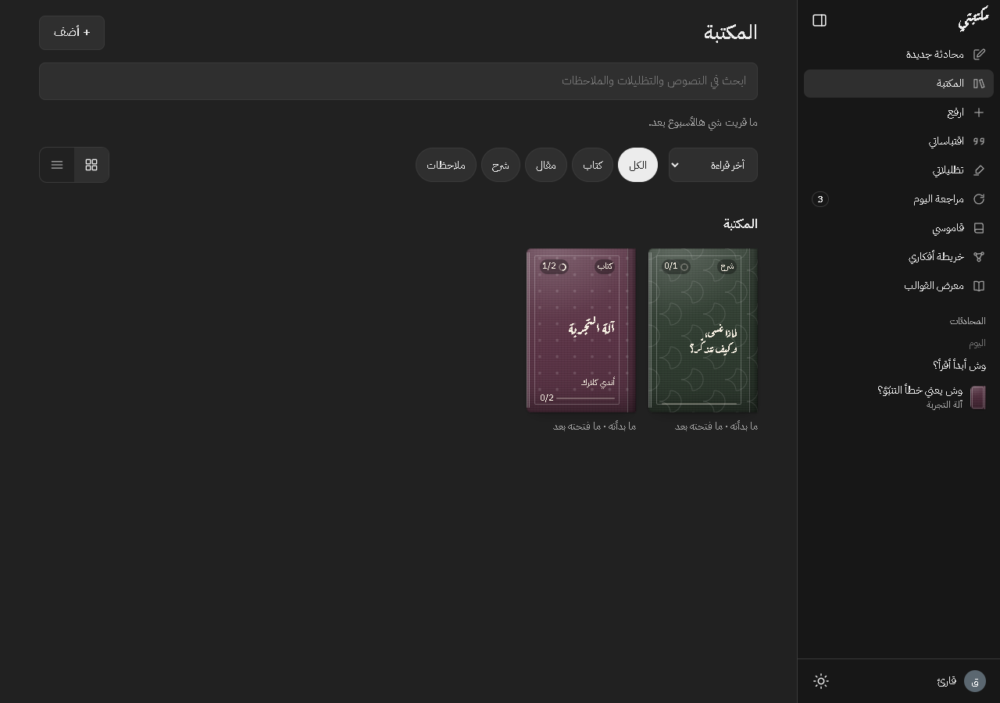

# Maktabati (مكتبتي)

[](https://github.com/abdulrmanfz0-glitch/maktabati/actions/workflows/ci.yml)

An Arabic-first reading environment. Bring your own PDF, EPUB, Markdown, or
plain-text book, read it in a comfortable reader, highlight and annotate it,
review what you read, play ambient sounds, and discuss the book with an AI
companion that knows your library.



*Library with demo books, search, filters, and reading progress.*

## What it does

- Imports PDF, EPUB, Markdown, and plain text locally; PDF/EPUB conversion runs
  in a Web Worker and never uploads the book to a server.
- Reads in three templates: Modern, The Book, and Manuscript, with scroll or
  paged reading, Arabic RTL/LTR support, font size, line spacing, text width,
  and diacritics controls.
- Saves highlights, notes, quotes, bookmarks, glossary terms, chapter cards,
  reading sessions, and spaced-review cards in the browser.
- Provides a canvas idea map, quote-card export, in-book search, and library
  search.
- Plays recorded rain, thunder, wind, fire, waves, and desert wind, plus a
  calm brown-noise fallback, through Web Audio.
- Talks to an OpenAI-compatible Chat Completions provider with your own key.

Everything is local-first: books and study data live in IndexedDB on the
device. The AI provider receives only the context needed for a request.

## Requirements

- Node.js **22.13 or newer** (see `.nvmrc`; `pdfjs-dist` requires
  `>=22.13`).
- npm.
- A modern browser. Chrome/Edge is the best-tested target. Firefox and Safari
  are not fully verified.

## Run locally

```bash
npm install
npm run dev
```

Open <http://localhost:5173>. The dev server uses Vite; there is no separate
backend. The first load creates two demo items so the library is not empty.

The old single-file `My Library.html` is no longer part of the repository.

## Add an AI key

1. Create a key with a spending limit.
2. Open **Profile → AI** (`#/profile/ai`).
3. Paste the key and press **Save**. The app detects the provider, fills the
   base URL, model and token limits, verifies `GET /models`, and saves.
4. Press **Test connection**.

Use the **custom / local endpoint** link only for Ollama, LM Studio, or another
endpoint that is not one of the known providers. A generic `sk-` key is checked
against DeepSeek, then OpenAI; every other key is sent only to the detected or
chosen provider.

The key is stored only in this browser's `localStorage` under
`maktabati:ai`. It is never included in library exports. See
[`SECURITY.md`](SECURITY.md).

### Multiple connections and pinned models

You can save more than one AI connection, one per provider or custom endpoint.
Each connection keeps its own key, base URL, and token limits. A key unlocks all
of that provider's models, but only the models you pin appear in the chat
switcher and in the per-task defaults (chat, translation, and chapter cards).
Pin only what you use. Keys stay in this browser's `localStorage` on this
device, and a key is sent only to its own connection's base URL — never to
another provider, and never into a library export. When a conversation switches
models, only that conversation changes; the task defaults stay where you put
them.

## AI providers that work from the browser

The app sends a browser `fetch` request directly to the provider. That means
the provider must allow **CORS** from the app's origin.

| Provider | From the browser |
|---|---|
| DeepSeek | Works (default base URL `https://api.deepseek.com`, model `deepseek-flash`) |
| OpenRouter | Works with its OpenAI-compatible base URL |
| Google Gemini API | Reachable through its OpenAI-compatible endpoint `https://generativelanguage.googleapis.com/v1beta/openai`. The app prefers `gemini-3.1-flash-lite`, then the newest flash id in `/models`, and retries a busy model with `gemini-3.1-flash-lite`/`gemini-3.5-flash-lite` when available. Gemini keys may start with `AIza` or `AQ.`; the OpenAI-compatible path uses `Authorization: Bearer`. Gemini 3 models think by default and count thinking tokens against the output limit, so the app sends `reasoning_effort: "low"` for this host. Reader chat has a per-conversation search toggle for search-capable models; search uses the native streaming endpoint (`/v1beta/models/{model}:streamGenerateContent?alt=sse`) with `x-goog-api-key` and `tools: [{ googleSearch: {} }]`. Test one request before relying on it. |
| Anthropic API (Claude) | Works through `https://api.anthropic.com/v1/chat/completions` with `Authorization: Bearer` plus `anthropic-dangerous-direct-browser-access: true`. Model discovery uses `x-api-key` and `anthropic-version: 2023-06-01`. ZDR/Compliance organizations may reject browser requests. |
| OpenAI official API | CORS is observed to work, but OpenAI does not document it and advises against exposing keys in browsers. Use a proxy or OpenRouter for production. |
| Any OpenAI-compatible endpoint with CORS (Groq, Together, Fireworks, LM Studio, vLLM, Ollama with `OLLAMA_ORIGINS` configured) | Works when it accepts `Authorization: Bearer` and the OpenAI Chat Completions request/response shape |

There is no server-side AI proxy in this repository. For a key that never reaches
the browser, or for a provider whose browser support is not documented, add a
proxy (planned in `apps/api`, not implemented).

## Limits, timeouts, and destructive actions

### Upload and import

- EPUB archives are rejected before extraction when they contain more than
  **5,000 entries**, an entry larger than **64 MB** after decompression, more
  than **256 MB total** after decompression, or a compression ratio above
  **100:1** for an entry larger than 1 MB.
- Pasted text is capped at **2,000,000 characters**. Files are capped at
  **250 MB**.
- On a device reporting **4 GB of memory or less**, a file larger than **25 MB**
  asks for confirmation before it is processed.
- Library import is atomic: validation, duplicate detection, and figure decoding
  happen before one IndexedDB transaction. A bad file changes nothing.
  Duplicate ids/content hashes are skipped. Unknown export versions are rejected;
  files without a version are treated as version 1.
- The JSON parse and `validateLibrary` check run in the ingest Worker when it is
  available; a failed worker falls back to the main thread.

### AI requests

- First-byte timeout: **90 seconds** by default, editable in
  **Profile → AI → Advanced options** (5–300 seconds).
- Stream-idle timeout: **20 seconds** without a new chunk.
- The Stop button, closing the chat, and deleting the conversation all abort the
  same request.
- Transient **429/500/502/503/504** responses are retried up to **2 times**
  (3 attempts total) with 500 ms / 1 s backoff, honouring `Retry-After` up to 15
  seconds. Retries stop once stream content has been shown.
- Default response cap: **1,200 tokens** for chat and **700** for chapter cards.
  Default context window: **64,000 tokens**; both are editable.
- Before sending, the app estimates the request and trims in this order: oldest
  history, then the library map/context sections, then the chapter text around
  the current reading position or selection. It does not send a request it knows
  will exceed the window.
- Empty API keys are allowed only for `localhost`/`127.0.0.1` (for example
  Ollama). The `Authorization` header is omitted when the key is empty. A key is
  never sent to a non-HTTPS base URL unless it is localhost.

### Deleting

- **Delete all data** (without the checkbox) removes books, annotations,
  conversations, and reading settings. It intentionally leaves the AI key, the
  idea-map positions/pins, and sound mixes.
- The checkbox in that dialog also removes the AI key, the idea-map layout, the
  sound mixes, and every `maktabati:*` / `reader:*` setting.

## Build

```bash
npm run build          # dist/web (needs a server) + dist/single (one file)
npm run build:single   # worker, then the self-contained dist/single/index.html
npm run preview        # preview the web build
```

The single-file build inlines scripts, fonts, and the ingest worker, so it can
be opened by double-clicking `dist/single/index.html`. Its limitations:

- it has no recorded nature sounds; only the calm brown-noise option;
- AI requests from a `file://` page can be blocked by the provider's CORS
  policy, so serve the file from a local server if AI does not connect;
- PDF/EPUB import works offline, from the embedded worker.

Production builds receive a Content Security Policy. Dev mode does not, so Vite
HMR keeps working. The normal web build uses a SHA-256 hash for its one inline
theme script; the single-file build uses `'unsafe-inline'` for scripts because
the whole app is inlined by `vite-plugin-singlefile`.

## Privacy

- The API key stays in the browser's `localStorage` on this device. It is not
  sent anywhere except the provider base URL you configure, and it is not part
  of library exports.
- The book, highlights, notes, quotes, chats, and chapter cards are stored in
  IndexedDB on this device. There is no Maktabati server.
- When you ask the AI a question, the relevant book text, highlights, notes,
  and chat messages are sent to the provider you configured. If you enable
  "allow the whole book", the whole book is sent. Review the provider's privacy
  and data-retention terms.
- The app loads no analytics and no tracking beacons of any kind; there is
  nothing to enable on self-hosted builds.
- OCR of scanned books runs fully on this device (Tesseract, self-hosted).
  The recognition files download once, from this site only, and book pages
  never leave the device.
- Remote images in imported Markdown, imported HTML, and AI replies are not
  loaded. They are shown as plain links or alt text. Local `data:image/...` and
  `blob:` images are displayed.
- Exported JSON is not encrypted. Treat exports as private files.

## Known limitations

- **PDF extraction is heuristic.** The engine is tested on seven Arabic PDFs
  from a single publisher; it is not a guarantee for every PDF. Scanned/image-
  only PDFs are not supported: the preview is disabled and nothing is saved.
  Table-heavy and multi-column layouts can still come out imperfectly.
- **Large books are memory-hungry.** A 43 MB image-heavy PDF produced 67.5 MB
  of figures and a 91 MB export in testing; peak PDF-import memory reached
  about 506 MB on one 284-page file. Mobile devices may run out of storage or
  memory. The library export/import cap is 250 MB.
- **No OCR/vision.** There is no image-reading model in the app.
- **No Word/DOCX import.** Only PDF, EPUB, Markdown, and plain text.
- **No PWA/offline web build yet.** There is no service worker or manifest. The
  single-file HTML is the offline option, with the limits above.
- **No accounts, sync, or server proxy.** Data does not move between devices
  unless you export/import JSON.
- **Settings, the idea-map layout, and sound mixes are not included in
  library exports.** They are stored in `localStorage`, not in the export
  format.
- **Browser coverage is incomplete.** Real iOS/Android devices, Firefox,
  Safari, fullscreen, and screen readers are not fully verified.
- **Remote images are blocked by design.** External images in books or AI
  replies render as links/alt text.
- **The AI key is visible to JavaScript on the same origin.** Use a
  spending-limited key and a dedicated origin; see `SECURITY.md`.

## Contributing

Read [`CONTRIBUTING.md`](CONTRIBUTING.md) before opening a PR. CI runs
`npm test`, `npm run build`, the smoke suite, and the AI failure suite on Node
22.13. Local performance checks use:

```bash
npm run dev -- --host 127.0.0.1
npm run bench:ui -- http://127.0.0.1:5173/
```

The methodology and current numbers are in
[`docs/performance.md`](docs/performance.md). Planned work is in
[`ROADMAP.md`](ROADMAP.md); recent changes are in
[`CHANGELOG.md`](CHANGELOG.md).

## License

Maktabati is licensed under **AGPL-3.0-only**. See [`LICENSE`](LICENSE).
Third-party components and assets are listed in
[`THIRD_PARTY_NOTICES.md`](THIRD_PARTY_NOTICES.md); full license texts are in
[`licenses/`](licenses/).

---

## العربية

«مكتبتي» بيئة قراءة عربية محلية: تستورد PDF أو EPUB أو Markdown أو نصًا،
وتقرأه في ثلاثة قوالب، وتظلّل وتدوّن وتلخّص وتراجع، وتشغّل أصواتًا محيطة،
وتناقش الكتاب مع رفيق ذكاء اصطناعي.

- **التشغيل:** Node.js 22.13 أو أحدث، ثم `npm install` و`npm run dev`، وافتح
  <http://localhost:5173>.
- **المفتاح:** من **الملف ← الرفيق الذكي** (`#/profile/ai`). الافتراضي
  DeepSeek (`deepseek-flash`)، ويمكن استخدام أي مزوّد متوافق مع OpenAI Chat
  Completions يدعم CORS. Gemini يعمل عبر واجهته المتوافقة مع OpenAI، وClaude
  كذلك مع ترويسة CORS خاصة، وOpenAI الرسمي غير موثق للمتصفح.
- **عدة اتصالات:** تقدر تحفظ أكثر من اتصال، واحد لكل مزوّد أو نقطة نهاية
  مخصّصة، ولكل اتصال مفتاحه ورابطه وحدوده. المفتاح يفتح كل موديلات مزوّده،
  لكن ما يظهر في مفتاح المحادثة وفي افتراضيات المهام (الدردشة والترجمة
  وبطاقات الفصول) إلا الموديلات اللي تثبّتها بنفسك. المفاتيح تبقى في
  `localStorage` على جهازك، ولا تُرسل إلا إلى مزوّد الاتصال نفسه، ولا تدخل في
  «تصدير المكتبة».
- **الخصوصية:** الكتب والتظليلات في IndexedDB على جهازك، والمفتاح في
  `localStorage`. عند السؤال تُرسل المقاطع ذات الصلة إلى مزوّد الذكاء الذي
  اخترته. التطبيق لا يحمّل أي تحليلات أو أدوات تتبع إطلاقًا، وقراءة نص الكتب
  الممسوحة تتم على جهازك بالكامل: ملفات التعرف تنزّل مرة واحدة من موقع
  التطبيق فقط، والصفحات لا تخرج من جهازك. الصور الخارجية محجوبة وتظهر كروابط أو نص بديل.
- **الحدود:** EPUB أكبر من 5,000 ملف، أو 64MB للملف الواحد، أو 256MB بعد فك
  الضغط، أو نسبة ضغط أعلى من 100:1 يُرفض. النص الملصوق حتى 2 مليون حرف،
  والملفات حتى 250MB، وفوق 25MB على جهاز بذاكرة 4GB أو أقل يظهر تأكيد.
- **الذكاء:** مهلة أول رد 90 ثانية (قابلة للتعديل)، وسكون البث 20 ثانية.
  يعيد المحاولة مرتين على 429/500/502/503/504، ويقصّ السياق عند الحاجة. مفتاح
  فارغ مسموح لـlocalhost فقط، والمفتاح لا يُرسل إلى HTTP غير محلي.
- **الحذف:** «احذف كل البيانات» الافتراضي يحذف الكتب والتظليلات والمحادثات
  وإعدادات القراءة، ويُبقي المفتاح والخريطة والأصوات. خيار checkbox يحذفها كلها.
- **البناء:** `npm run build` ينتج `dist/web` و`dist/single`؛ نسخة الملف
  الواحد تعمل بلا سيرفر لكن أصواتها الطبيعية غير مضمّنة.
- **الترخيص:** AGPL-3.0-only، مع إشعارات الطرف الثالث في
  `THIRD_PARTY_NOTICES.md`.
- **ملاحظة:** المشروع ليس PWA بعد، ولا يدعم الكتب الممسوحة (OCR)، ولا
  Word/DOCX، ولا المزامنة بين الأجهزة.
